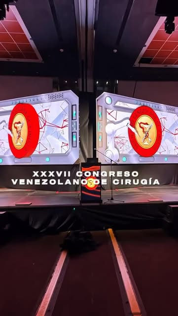

# RMSOUND Web

Sitio web estático para RMSOUND: sonido profesional para eventos, iluminación, pantallas LED, escenarios y producción integral.

## Archivos
- `index.html` — estructura del sitio
- `styles.css` — estilos (negro/morado, luces neon, parallax)
- `script.js` — interactividad, canvas LED, cotización
- `assets/img/` — imágenes descargadas de Instagram (@rmsound)

## Configuración
Edita en `script.js`:
- `WHATSAPP_NUMBER` (por defecto `584144533064`)
- `CONTACT_EMAIL` (por defecto `contacto@rmsound.com`)

La sección de cotización genera un mensaje y lo envía por WhatsApp y correo (mailto). También permite copiar al portapapeles.

## Ejecutar
Abre `index.html` en el navegador, o sirve la carpeta con cualquier servidor estático.

## Despliegue
Sube la carpeta completa (incluyendo `assets/`) a tu hosting (Netlify, Vercel, GitHub Pages, etc.).